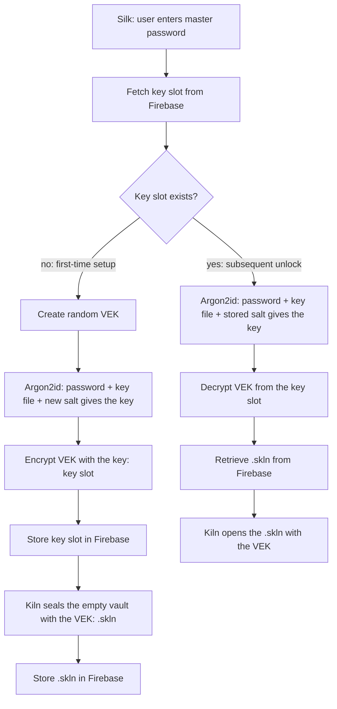

# Silk architecture: Silk, Kiln, VEK and Firebase

This is the written form of the flow diagram. Status of each piece is in the task list at the bottom.

## Names

| Name | Meaning | Where it lives |
|---|---|---|
| **Silk** | This app: the password manager, formerly called PassVault. Master-password entry, unlock/save, the unlocked state in memory. | this repository |
| **Kiln** | A separate project: a multicore archiver (Rust engine + Android app) with its own container format. Today it writes `.kiln` v2 archives (you call them `.kln`; in Kiln's own docs `.kln` is the original Python app's format). | `kiln-rust` repository |
| **`.skln`** | A new Kiln archive type, **not written yet**: the encrypted archive that holds Silk's entries, keyed by the VEK. | to be added to Kiln |
| **VEK** | Vault Encryption Key: 256 random bits, generated once at first-time setup. Encrypts the `.skln`. | in memory only; stored wrapped |
| **Key** | The Argon2id output (the diagram's "key"; KEK in code comments). Only ever wraps the VEK. | derived on demand, never stored |
| **Key slot** | The VEK encrypted by the key, plus the Argon2id settings and salt needed to re-derive it. 91 bytes. | `core/src/keyslot.rs` |
| **`Archiver`** | The seam between Silk and Kiln: a small trait for "seal entries with the VEK / open them again". | `core/src/archive.rs` |
| **Interim archiver** | A stand-in implementation of `Archiver` so the cloud flow can be built and tested before `.skln` exists. **Not the `.skln` format**: different magic (`SKIM`) and object name (`vault.interim`). | `core/src/interim.rs` |
| **Local store** | The on-device copy of the key slot and vault file in the app's private folder. It implements `RemoteStore`, so unlocking from the local copy runs the same flow as unlocking from Firebase will. Also holds the rollback mark. | `core/src/local.rs` |
| **Session** | The unlocked state the app holds (VEK + entries), idle lock, saves to the local store, backup and restore. | `core/src/session.rs` |
| **Backup** | One `.silk` file: key slot + vault file. | `core/src/backup.rs` |
| **Legacy vault** | The pre-key-slot `.pvlt` container (`PVLT` magic), where the Argon2id key encrypted the entries directly. Still read for migration and old backups. | `core/src/vault.rs` (`Vault`) |

## Flow



Saving: the archiver re-encrypts the entries with the VEK under a fresh nonce and revision + 1, then Silk stores the result.
Changing the master password: only the key slot is re-wrapped and stored; the vault file is untouched.

## Where this differs from the drawing

1. **YES/NO on "Subsequent unlock?" are swapped in the diagram.** As drawn, YES creates a random VEK and NO retrieves it. The code does the logical thing: no key slot in the cloud means first-time setup; a key slot means subsequent unlock.
2. **Argon2id comes after the key-slot fetch, not before the decision.** The salt and cost settings are stored in the key slot, so Silk must fetch it before it can derive the key.
3. **The `.skln` is encrypted with the VEK, not with the Argon2id key directly.** The right-hand path in the drawing (retrieve VEK, decrypt VEK, Kiln decrypts `.skln`) only makes sense that way.

## What Silk needs from `.skln` (the contract for the Kiln side)

I read the Kiln repository to see what exists. Kiln's public API (`pack`, `Archive::open`, `extract`) works on file paths, and its password lock (`kiln-bridge/src/lock.rs`) wraps a whole plain archive in scrypt + ChaCha20-Poly1305 records and uses scratch folders and `/dev/urandom`. That is the right idea but not what Silk can call as is. For `.skln`, Silk needs:

1. **A raw 32-byte key, no password KDF.** Silk runs Argon2id itself (that is the diagram) and hands over the VEK. A second KDF (scrypt) inside the archive would be redundant.
2. **An in-memory API: bytes in, bytes out.** No paths, no temp files. The vault is a few hundred KB. Randomness through `getrandom` (works on Android and everywhere else), not `/dev/urandom`.
3. **An authenticated revision counter** in the plain header, readable without the key. Silk uses it to notice a server replaying an old file.
4. **A lean dependency set.** The `kiln` crate currently pulls `clap`, `anyhow`, `walkdir`, `tempfile`, `zstd` and `liblzma` (C code) unconditionally. Silk's Android library is built for size (`opt-level = "z"`), so either a feature flag that builds only the `.skln` reader/writer, or a small separate crate for it, would keep Silk's `.so` from growing by the whole archiver.
5. **Toolchain:** Kiln is edition 2024 / Rust 1.88; Silk's workspace is edition 2021 and CI pins an older toolchain. Depending on Kiln means Silk's CI moves to Rust 1.88 or later. The UI crates differ too (Silk uses Slint 1.8, Kiln 1.18.1 with Skia); that only matters if both ever share one Cargo workspace, and a dependency on the `kiln` crate alone avoids it.
6. **Cipher choice is open.** Kiln uses ChaCha20-Poly1305, Silk's key slot uses AES-256-GCM. Either works for a random VEK; using one for both keeps the Android library smaller.
7. **The browser extension reads the vault in JavaScript today.** If it should open `.skln`, the format needs a JS reader too (Kiln has none), so a simple, well-specified container is worth it.

Once `.skln` exists: write `impl Archiver for <Kiln adapter>` and change `archive::Current`. Nothing in `cloud.rs`, `keyslot.rs` or `remote.rs` should need to change. Keep `interim.rs` as a read-only source: devices will by then hold real vaults in the interim format (see Known limits), and they need converting to `.skln` on unlock.

## Formats

All integers are big-endian.

```
key slot  "SKVK" | version u8 | flags u8 (bit0 = key file) | t u32 | memKiB u32 | p u8 | salt[16] | nonce[12] | AES-256-GCM(VEK) + tag[16]
          first 31 bytes are the associated data; total 91 bytes

interim   "SKIM" | version u8 | flags u8 | revision u64 | nonce[12] | AES-256-GCM(archive) + tag[16]       (stand-in, see above)
archive   count u32 | { name_len u16 | name | data_len u32 | data }*
          one member today: "vault.json" = {"entries":[...]}  (same entry shape as the old vault)

backup    "SKBK" | version u8 | key slot[91] | vault file (the rest)
```

The browser extension reads the backup (`browser-extension/src/vault.js`) and, as before, old `.pvlt` files. Its vault-file part follows the interim format, so it changes together with `interim.rs`.

Key derivation is unchanged from the old vault: `SHA-256(password)`, mixed with `SHA-256(key file)` when a key file is used, then Argon2id (t=3, 64 MiB, p=4 by default) to 32 bytes. Existing key files keep working.

## On-device files

In the app's private folder (`core/src/local.rs`):

```
keyslot.skvk     the key slot
vault.interim    the vault file (vault.skln later)
vault.pvlt       an old vault, only until the first unlock converts it
seen.rev         highest vault revision this device has seen
```

Silk reads and writes these through the same `RemoteStore` trait the Firebase transport will implement. A save writes the key slot (only if it changed), then the vault file, each through a temporary file and a rename.

**First unlock of an old vault.** If there is no key slot but a `vault.pvlt`, the master password opens the old file, a new VEK is drawn, the key slot and vault file are written, and only then is `vault.pvlt` removed. A wrong password changes nothing. Biometric unlock is switched off at that point, because the Keystore holds the old vault key, not the VEK; the user turns it on again.

**Restoring a backup** accepts a `.silk` bundle or an old `.pvlt` file (kept as `vault.pvlt` and converted on the next unlock). Restoring clears the rollback mark, because it is the one deliberate way to go back to an older vault.

## Firebase layout

Firebase Storage, one folder per signed-in user:

```
vaults/<uid>/keyslot.skvk
vaults/<uid>/vault.skln        (vault.interim while the stand-in is in use)
```

Rules are in `firebase/storage.rules` (each user reads and writes only their own files, 20 MB cap, no deletes). Everything stored is ciphertext, so Firebase is treated as untrusted storage. Core only sees the `RemoteStore` trait (`core/src/remote.rs`); the Firebase implementation is a later task.

The Firebase account (who may download the files) and the master password (who can decrypt them) are separate. Anyone who can download the two files can try passwords offline, so Argon2id cost and password strength are what protect the vault if the Firebase account is compromised.

## Known limits (by design, for now)

- **Rollback:** the revision is authenticated, and the device keeps the highest one it has seen (`seen.rev`). Unlock and biometric unlock refuse a vault file with a lower revision (`Error::Rollback`); every save raises the mark. Today this guards the local copy. When the Firebase transport lands, the downloaded file must go through the same check before it replaces the local one. The mark is a plain file: someone who can write the app's private folder can also replace the vault, so this is aimed at a malicious server, not at an attacker with device access.
- **No VEK rotation.** Changing the password re-wraps the same VEK. Rotating it needs the key slot and the vault file to change together, which two separate uploads can't do atomically.
- **No merge.** Two devices saving from the same revision: last write wins.
- **Upload order** is key slot first, then vault file, so a half-finished first-time setup leaves a slot without a vault file (accepted as an empty vault), never a vault file nobody can open.
- **The app is local-only for now:** it uses `CloudVault` over the local store and has no network permission until the Firebase transport lands.
- **Real vaults are now written in the interim format** (`vault.interim`, magic `SKIM`). When `.skln` arrives, `interim.rs` cannot simply be deleted: it has to stay as a read-only source so existing vaults can be converted to `.skln` on unlock (the two have different file names, so telling them apart is easy). The same goes for the backup bundle, which embeds whichever vault file is current.

## The PassVault to Silk rename

Done everywhere: crates (`silk`, `silk-core`), the library (`libsilk.so`), the Android package and application ID (`app.silk`), the Java classes (`SilkActivity`, `SilkApp`), the JNI symbol names, `Theme.Silk`, the Gradle project name, the Slint components (`Silk*`), shared-preference and Keystore names, the CI artifacts and the extension's package name.

Left on purpose:

- **The `PVLT` magic and `.pvlt` extension** identify the old container. The app and extension still read it (migration, old backups). New backups are `.silk`.
- **`core/src/vault.rs` keeps its name** because `Entry`, `Kdf` and the key derivation live there; the legacy `Vault` struct in it is documented as such.

**What the new application ID means for existing installs.** `app.silk` is a different app to Android. It installs next to the old `app.passvault`, does not update it and cannot read its data. To move over: in the old app use Back up (it saves a `.pvlt` file), install Silk, choose Restore from backup on its first screen and unlock with the same master password; the vault is converted then. The Keystore key behind biometric unlock is per app, so biometric unlock is set up again in Silk. Autofill has to be switched to Silk in Android's settings.

## Tasks

| # | Task | Status |
|---|---|---|
| 1 | Map the diagram to the codebase; this document | done (revised for Silk/Kiln) |
| 2 | `Archiver` trait + interim stand-in archive (`archive.rs`, `interim.rs`) | done |
| 3 | Key slot: Argon2id key wraps the VEK (`keyslot.rs`) | done |
| 4 | `CloudVault` flow: setup, unlock, save, change password, legacy `.pvlt` migration, VEK export for biometrics, `RemoteStore` trait (`cloud.rs`, `remote.rs`) | done |
| 5 | Firebase layout and security rules (`firebase/storage.rules`) | done |
| 6 | **Kiln repo (yours):** add `.skln` with the contract above | todo |
| 7 | Add a Kiln-backed `Archiver`, switch `archive::Current`, convert interim vaults to `.skln` on unlock (keep `interim.rs` as the reader); move Silk's CI toolchain if needed | todo, after 6 |
| 8 | Session uses `CloudVault`: local copy of key slot + vault file in private storage (offline unlock), migrate `vault.pvlt` on first unlock (`local.rs`, `session.rs`, `backup.rs`) | done, untested on a device |
| 9 | Firebase transport: Firebase Auth + Storage over HTTPS in the Java glue, `RemoteStore` bridge in Rust, `INTERNET` permission, project config | todo |
| 10 | Biometric unlock wraps the VEK (`export_vek` / `unlock_with_vek`) instead of the old vault key | done (stale keys are detected and reset) |
| 11 | Sync safety: rollback detection from the revision (done, local), conflict handling, VEK rotation with an atomic commit | partly: rollback guard done; conflicts and rotation todo |
| 12 | UI: first-time setup vs unlock, sync status, change password, migration prompt | partly: setup/unlock and a migration notice exist; sync status and change password todo |
| 13 | Browser extension reads key slot + vault file | done for the interim format and old `.pvlt`; `.skln` reader todo, after 6 |
| 14 | The deeper PassVault to Silk rename (package, crates, library) | done, see above |
